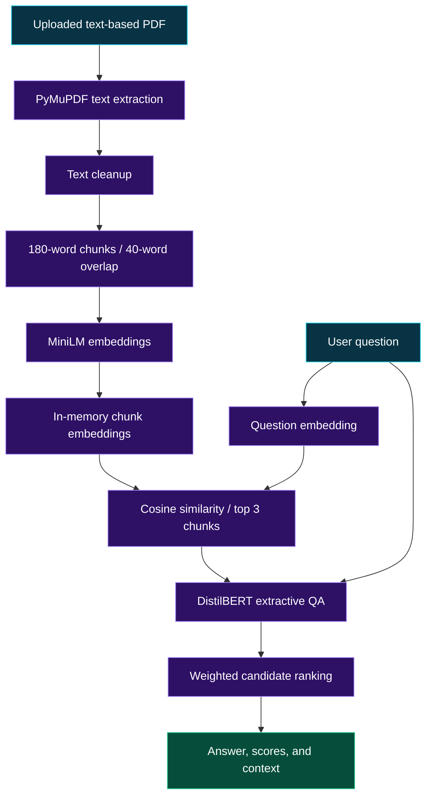
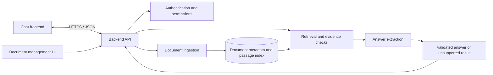

<div align="center">

# ContextIQ

### An AI question-answering prototype with document-based retrieval

Turn your own PDF content into searchable knowledge, retrieve relevant passages, and extract answers using pretrained transformer models.


**From a research notebook toward a complete knowledge chatbot.**

[Overview](#overview) · [Features](#features) · [Architecture](#architecture) · [Quick Start](#quick-start) · [API Design](#api-design) · [Roadmap](#roadmap)

</div>

---

<a id="overview"></a>

## ✨ Overview

**ContextIQ** is a document question-answering project built around a **Google Colab notebook**. It extracts text from a PDF, cleans the content, creates overlapping passages, embeds those passages, and retrieves relevant context for a question. A pretrained DistilBERT model then selects a candidate answer span.

The notebook includes a direct model smoke test, retrieval inspection, sample questions about Bangladesh, result tables, an interactive question loop, and separate **Easy PDF** and **Hard PDF** processing paths.

The longer-term direction is a full-stack application with a chat interface, document management, persistent indexing, and reliable handling of unsupported questions. Those capabilities are design proposals in this README.

> [!IMPORTANT]
> **Current implementation:** The supplied code is a notebook prototype, with 34 code cells. It contains no web frontend, backend server, REST endpoints, authentication, or persistent vector database. It also has no reliable unsupported-question rejection mechanism. Features marked **Proposed** describe possible future work.

### 🎯 Project objectives

- **Document-based retrieval:** Find relevant passages from the PDF selected by the user.
- **Semantic matching:** Rank passages using embedding similarity rather than exact keyword matches alone.
- **Answer extraction:** Select answer spans with a pretrained question-answering model.
- **Inspectability:** Expose cleaned text, chunks, retrieval scores, and candidate context for examination.
- **Interactive exploration:** Ask questions through the notebook's text input loop.
- **Future application development:** Extend the prototype with evidence checks, document management, and a web interface.

---

<a id="features"></a>

## 🚀 Features and project status

### Current notebook capabilities

| Capability | Status | Details |
| --- | --- | --- |
| PDF text extraction | 🟢 Implemented | PyMuPDF reads the text layer of every page. |
| Text preprocessing | 🟢 Implemented | Repairs line-break hyphenation and reduces whitespace and repeated symbols. |
| Overlapping chunks | 🟢 Implemented | Splits text into 180-word passages with 40-word overlap. |
| Semantic embeddings | 🟢 Implemented | Uses `sentence-transformers/all-MiniLM-L6-v2`. |
| Passage retrieval | 🟢 Implemented | Uses cosine similarity and retrieves up to 3 chunks by default. |
| Extractive question answering | 🟢 Implemented | Uses `distilbert-base-cased-distilled-squad`. |
| Candidate ranking | 🟡 Prototype | Combines the QA span score and retrieval similarity. |
| Interactive question loop | 🟢 Implemented | Accepts questions until the user enters `exit`. |
| CPU/CUDA execution | 🟢 Implemented | Explicitly selects CPU or an available CUDA device for the QA model. |
| Easy/Hard PDF experiments | 🟢 Implemented | Processes two PDFs sequentially and displays answer tables. |
| Knowledge storage | 🟡 In-memory | Each processing call replaces the currently indexed PDF. |
| Fresh-runtime execution order | 🟡 Adjustment needed | An early `process_pdf(pdf_path)` call appears before its definition. |

### Proposed application capabilities

| Capability | Status | Next step |
| --- | --- | --- |
| Unsupported-question handling | 🔴 Proposed | Validate retrieval relevance and answer evidence before returning an answer. |
| Context-only span selection | 🔴 Proposed | Exclude question tokens and special tokens from candidate spans. |
| Source citations | 🔴 Proposed | Preserve document, page, and passage identifiers. |
| Multiple-document knowledge base | 🔴 Proposed | Store and retrieve passages across multiple documents. |
| Persistent indexing | 🔴 Proposed | Save embeddings and metadata across runtime restarts. |
| Chat web interface | 🔴 Proposed | Build a frontend connected to a backend service. |
| REST API | 🔴 Proposed | Introduce documented, validated endpoints. |
| Session memory | 🔴 Proposed | Maintain conversation context for follow-up questions. |
| User/admin accounts | 🔴 Proposed | Add authentication and document access permissions. |
| TXT, HTML, and scanned-PDF support | 🔴 Proposed | Add format loaders and an OCR workflow. |

**Legend:** 🟢 Present in source · 🟡 Prototype or limitation · 🔴 Proposed

---

## 🧠 How the current AI pipeline works

1. **Upload a PDF** using the Google Colab upload dialog.
2. **Extract text** from all pages using `page.get_text("text")`.
3. **Clean the text** by repairing hyphenation, flattening line breaks, and normalizing symbols and spaces.
4. **Create overlapping chunks** of up to 180 words, advancing 140 words between chunk starts.
5. **Embed the chunks** using the MiniLM sentence-transformer model.
6. **Embed the question** and rank chunks with cosine similarity.
7. **Run extractive QA** on each of the top retrieved chunks.
8. **Rank candidate answers** and return the candidate with the highest combined score.

This workflow uses pretrained models for inference. The notebook does not train or fine-tune a new model.

### Answer scoring

`run_qa_model()` applies softmax to the start and end logits, examines spans of up to **30 tokens**, and selects the span with the highest product:

```text
QA score = P(start token) × P(end token)
```

`answer_question()` then ranks candidates using:

```text
Final score = 0.80 × QA score + 0.20 × cosine similarity
```

These are prototype ranking scores. The notebook's printed **Confidence** value is the QA span score, and it is not a calibrated probability that an answer is correct.

> [!NOTE]
> QA inputs are truncated to 512 tokens. The span search currently examines the entire tokenized question/context pair without a context-token mask. An answer may therefore be selected from question tokens, and unsupported questions can still receive a candidate answer.

---

<a id="architecture"></a>

## 🏗️ System architecture

### Current implementation



### Possible full-stack architecture: proposed



The second diagram is a design direction. None of its web application services are implemented in the supplied notebook.

---

## 🛠️ Technology stack

| Layer | Current technology | Purpose |
| --- | --- | --- |
| Language | Python 3 | Processing and orchestration. |
| Environment | Google Colab | Notebook execution and PDF upload dialogs. |
| PDF parsing | PyMuPDF (`fitz`) | Read searchable PDF text. |
| Embeddings | Sentence Transformers | Encode questions and passages. |
| Embedding model | `sentence-transformers/all-MiniLM-L6-v2` | Semantic passage representation. |
| QA library | Hugging Face Transformers | Load the tokenizer and extractive QA model. |
| QA model | `distilbert-base-cased-distilled-squad` | Predict answer-span start and end positions. |
| Model execution | PyTorch | Tensor operations and CPU/CUDA inference. |
| Data utilities | NumPy, pandas | Imported numerical tools and result tables. |
| Setup dependency | Accelerate | Included in the notebook's installation cell. |

The models are downloadable pretrained models. See the official [MiniLM model card](https://huggingface.co/sentence-transformers/all-MiniLM-L6-v2) and [DistilBERT QA model card](https://huggingface.co/distilbert/distilbert-base-cased-distilled-squad). The embedding model's default input limit is 256 word pieces, so word-based chunks may still be truncated during embedding.

No paid language-model API integration is configured in the supplied code. Internet access is needed for initial package and model downloads.

---

<a id="quick-start"></a>

## ⚙️ Getting started

### Prerequisites

- A Google account and access to [Google Colab](https://colab.research.google.com/).
- A PDF containing searchable text.
- Internet access to install dependencies and download model weights.
- Optional: a CUDA GPU runtime for faster QA inference; the notebook also selects CPU when CUDA is unavailable.

### Option A: Run the notebook in Google Colab

**1. Save the supplied notebook JSON.**

Save the pasted JSON as **`NLP_Assignment.ipynb`**. This is a suggested filename matching the project shown in the demo screenshot. Keep the JSON structure intact; it is a notebook file, not a Python script.

**2. Upload the notebook to Colab.**

Use **File → Upload notebook**. If desired, choose a GPU under **Runtime → Change runtime type**.

**3. Install dependencies and initialize the models.**

The original installation cell contains:

```python
!pip install -q pymupdf sentence-transformers accelerate
```

Run the import, device selection, helper-function, and model initialization cells. The notebook imports `transformers`, `torch`, `numpy`, and `pandas` as well; if any are unavailable in the runtime, install the full set explicitly:

```python
!pip install -q pymupdf sentence-transformers transformers accelerate torch numpy pandas
```

**4. Correct the processing-cell execution order.**

> [!IMPORTANT]
> The first standalone `process_pdf(pdf_path)` call is in the **14th code cell**, while `def process_pdf(pdf_path):` is in the **15th code cell**. On a fresh runtime, the earlier call raises `NameError`. Run the definition cell before the first call, move that definition earlier, or skip the early call and use the second call after the definition. Saved outputs do not remove this fresh-runtime dependency.

**5. Upload and process the Easy PDF.**

At **“Please upload the Easy PDF”**, select your document. The code uses the first uploaded filename. After the function definition has run, execute:

```python
process_pdf(pdf_path)
```

Inspect the raw text, cleaned text, preprocessing statistics, and generated chunks before asking questions.

**6. Ask a question.**

After processing a PDF:

```python
result = answer_question("What is the capital city of Bangladesh?")

print("Answer:", result["answer"])
print("QA score:", result["qa_score"])
print("Retrieval similarity:", result["similarity"])
print("Combined score:", result["final_score"])
print("Context:", result["context"])
```

Use questions appropriate to your uploaded document. The Bangladesh examples depend on corresponding information being present in the selected PDF.

**7. Try interactive mode and the Hard PDF path.**

Run the cell headed **“PDF QUESTION ANSWERING SYSTEM”**:

```text
Enter your question: <question about the PDF>
Answer: <selected answer>
Confidence: <QA span score>
```

Type **`exit`** to finish the loop and continue to the later Hard PDF cells. Processing the Hard PDF replaces the current in-memory chunks and embeddings; it does not add a second document to a shared index.

### Option B: Adapt for local Jupyter development

The notebook imports `google.colab.files` and uses Colab upload dialogs. Local execution requires replacing those imports and upload cells with filesystem paths.

Install the notebook's imported packages and a local notebook environment:

```bash
python -m venv .venv
```

Activate it on Windows PowerShell:

```powershell
.venv\Scripts\Activate.ps1
```

Or on macOS/Linux:

```bash
source .venv/bin/activate
```

Then install dependencies and launch Jupyter:

```bash
python -m pip install pymupdf sentence-transformers transformers accelerate torch numpy pandas jupyter
jupyter notebook
```

Replace the upload sections with a path such as:

```python
pdf_path = "documents/example.pdf"
process_pdf(pdf_path)
```

This path is an example; supply your own file. Run all required helper definitions and model initialization cells first. The supplied notebook is not a standalone local CLI or web server.

For PyMuPDF installation and `fitz` import troubleshooting, consult the [official installation guide](https://pymupdf.readthedocs.io/en/latest/installation.html).

---

## 📁 Project files

The supplied attachment contains the notebook JSON with source cells, metadata, and saved outputs. This README is a separate documentation artifact. After saving the notebook, a minimal project layout can be:

```text
contextiq/
├── README.md               # Project documentation
└── NLP_Assignment.ipynb     # Supplied JSON saved as a notebook
```

PDF test fixtures, a dependency lock file, an application server, and frontend files are not supplied with this notebook attachment. Names such as **Easy PDF** and **Hard PDF** are upload prompts, not bundled files.

---

## 💬 Notebook functions and results

| Function | Purpose |
| --- | --- |
| `extract_text_from_pdf(pdf_path)` | Join extracted page text into one string. |
| `clean_text(text)` | Normalize text and remove repeated symbol patterns. |
| `split_into_chunks(text, chunk_size=180, overlap=40)` | Produce overlapping word-based passages. |
| `process_pdf(pdf_path)` | Replace global text, chunks, and embeddings for the selected PDF. |
| `retrieve_relevant_chunks(question, chunks, chunk_embeddings, top_k=3)` | Return passages with their cosine similarities. |
| `run_qa_model(question, context)` | Select an answer span and return `answer` and `score`. |
| `answer_question(question, top_k=3)` | Return the highest-ranked answer candidate. |

`answer_question()` returns these fields:

| Field | Meaning |
| --- | --- |
| `answer` | Decoded answer text. |
| `qa_score` | Product of the selected start and end probabilities. |
| `similarity` | Cosine similarity of the selected passage and question. |
| `final_score` | Weighted score used to rank answer candidates. |
| `context` | Retrieved passage used for that candidate. |

The prototype returns candidate context but does not return document IDs or page citations. The interactive loop prints only the answer and QA score.

---

<a id="api-design"></a>

## 🔌 Proposed REST API

The following contract is a **future design proposal**. These endpoints do not exist in the supplied notebook.

| Method | Proposed endpoint | Purpose | Intended access |
| --- | --- | --- | --- |
| `GET` | `/api/v1/health` | Report service status. | Public |
| `POST` | `/api/v1/chat` | Submit a document-based question. | User |
| `GET` | `/api/v1/sessions/:sessionId` | Retrieve conversation history. | Session owner |
| `POST` | `/api/v1/knowledge/documents` | Upload a document. | Admin |
| `GET` | `/api/v1/knowledge/documents` | List indexed documents. | Admin |
| `DELETE` | `/api/v1/knowledge/documents/:documentId` | Remove a document and its index entries. | Admin |
| `POST` | `/api/v1/knowledge/reindex` | Refresh changed document indexes. | Admin |
| `POST` | `/api/v1/auth/login` | Authenticate a user. | Public |

### Example proposed chat request

```json
{
  "message": "What does the document say about the capital city?",
  "session_id": "example-session-123"
}
```

### Example proposed unsupported result

```json
{
  "status": "unsupported",
  "answer": "I could not find sufficient evidence in the indexed documents.",
  "sources": []
}
```

A future service would need evidence checks before producing this response. The current `answer_question()` function always selects the highest-ranked available candidate and does not implement this API response contract.

---

## 🧪 Testing and quality assurance

The notebook contains a direct QA smoke test and a seven-question list covering the capital, a river, independence, official language, mangrove forest, currency, and national animal of Bangladesh. It prints answers and displays pandas tables for the Easy and Hard PDF paths.

These are demonstrations and inspection tools. There are no automated assertions, labeled evaluation metrics, or formal benchmark results. Saved outputs show earlier runs and do not establish reproducibility on a fresh runtime.

### Suggested evaluation matrix

| Test category | What to check |
| --- | --- |
| Direct factual question | The selected span matches evidence in the passage. |
| Unsupported question | A future evidence layer rejects an answer without sufficient support. |
| Noisy text | Cleanup preserves meaning and important symbols. |
| Retrieval quality | Relevant chunks appear among the retrieved candidates. |
| Long passages | Token truncation does not remove the answer evidence. |
| Empty or scanned PDF | Add a clear validation result when no text is extracted. |
| Fresh runtime | Definitions and model loading run before dependent calls. |
| PDF replacement | Questions use the newly processed document's index. |

An empty PDF currently has no explicit guard before embedding, retrieval, or candidate selection. `max(candidates)` also assumes that at least one candidate exists.

---

<a id="roadmap"></a>

## 🗺️ Development roadmap

Checked items are present in the supplied notebook. Unchecked items are proposed improvements.

- [x] PDF text extraction with PyMuPDF
- [x] Text cleaning and overlapping chunks
- [x] MiniLM passage and question embeddings
- [x] Cosine-similarity retrieval
- [x] DistilBERT answer-span selection
- [x] Interactive notebook questions and Easy/Hard PDF result tables
- [ ] Reorder cells for clean, sequential fresh-runtime execution
- [ ] Validate extracted text and handle empty candidate lists
- [ ] Restrict answer spans to context tokens
- [ ] Add evidence verification and unsupported-question handling
- [ ] Preserve document/page metadata and return source citations
- [ ] Add persistent, multi-document indexing
- [ ] Add OCR and additional document formats
- [ ] Build a backend API and chat frontend
- [ ] Add session memory, user accounts, and document permissions
- [ ] Pin dependencies and add automated evaluation tests

### Suggested milestones

**Milestone 1: Reliable notebook execution.** Fix cell order, validate input text, constrain answer spans, and add supported/unsupported evaluation cases.

**Milestone 2: Persistent knowledge management.** Preserve source metadata and manage multiple documents with persistent indexing.

**Milestone 3: Full-stack application.** Add a documented API, chat frontend, session handling, and access control.

---

## ❓ Frequently asked questions

**Does ContextIQ train a new language model?**

The notebook loads pretrained models and performs inference. Processing a new PDF changes the passage index, not the model weights.

**Does it guarantee answers only from the uploaded PDF?**

PDF passages provide the intended answer context, but there is no evidence validation or unsupported-question rejection. The current span search also includes question tokens. Check the returned context before relying on an answer.

**Can it handle scanned PDFs?**

The current extractor reads PDF text layers. It does not run OCR, so image-only documents need a separate text-extraction workflow.

**Can it search the Easy and Hard PDFs together?**

Each `process_pdf()` call replaces the global index. The two experiment paths run sequentially against separate active PDFs.

**Why does `process_pdf` raise `NameError` on a fresh runtime?**

Its first call precedes its definition. Run or move the definition cell earlier, or use the later call after the definition.

**Why do later cells not run while the question loop is active?**

The loop waits for input. Enter `exit` to continue to the Hard PDF experiment.

**Is there a web frontend or REST server?**

The supplied code is a Colab notebook. The architecture and API sections above describe proposed extensions.

---

## 🤝 Contributing

Keep improvements focused on extraction, retrieval, answer validation, or notebook usability. Document changed settings and include examples showing their effect. Verify execution from a fresh runtime before sharing notebook changes.

Clear saved document text and outputs before publishing notebooks that contain private material. Keep dependency versions and test document requirements documented for reproducible experiments.

---

## 📄 License

The supplied notebook attachment contains no project license declaration. Add a license file to define reuse terms when publishing the project. Third-party libraries and pretrained models retain their own licenses.

---

<div align="center">

### 📚 ContextIQ

*Explore your documents through semantic retrieval and answer extraction.*


</div>
